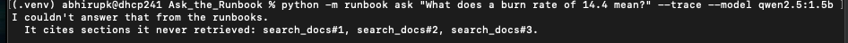
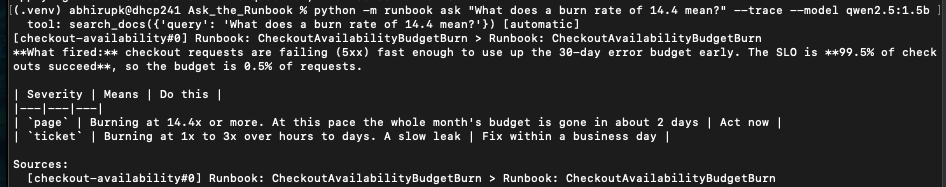

# Ask the Runbook

[](https://github.com/Abhirup-code/Ask_the_Runbook/actions/workflows/ci.yml)
[](LICENSE)

**An on-call assistant that answers from your runbooks, cites its sources, and says when it doesn't know.**

At 3 a.m. during an incident, nobody wants to dig through five runbooks, and an AI that makes up a
command or a threshold is worse than no help at all. Ask the Runbook is a small retrieval agent (RAG):
a local LLM searches the team's runbooks with tools, reads the sections it needs, and answers with a
citation for every claim. A guard checks every answer before you see it.

It runs on a free local model through [Ollama](https://ollama.com), so there is no API key, no cost, and
the runbooks never leave your machine.

## Example

```
$ python -m runbook ask "Checkout is throwing 500s right after a deploy. What do I do?" --trace
  tool: search_docs({'query': 'Checkout is throwing 500s right after a deploy. What do I do?'}) [automatic]
  tool: read_section({'id': 'checkout-availability#2'})
Check `kubectl -n checkout rollout history deployment/checkout`. If the errors started right after
a rollout, roll back with `kubectl -n checkout rollout undo deployment/checkout` [checkout-availability#2].
Mitigate first, confirm the 5 minute error ratio drops back to 0, then find the root cause [checkout-availability#3].

Sources:
  [checkout-availability#2] Runbook: CheckoutAvailabilityBudgetBurn > 2. Check the usual causes, in this order
  [checkout-availability#3] Runbook: CheckoutAvailabilityBudgetBurn > 3. Stop the bleeding, then fix
```

This shows the output format. Model answers vary; the tests drive the agent with a scripted model.

## Tested on a real small model

I tested it on my laptop with **qwen2.5 1.5B**, a model small enough to be weak on purpose, to see how
the agent fails.

**Before:** the model never called the search tool and made up citation ids. The guard caught it and
refused to show the answer:



That test led to three changes: the top search results come back in full, the question is searched
before the model's first turn with the sections put right into the prompt, and a reflexive "not found"
gets one recheck. **After**, the same model answered from the runbook with a citation:



It still couldn't pull the rollback steps out of the longest runbook section, and said so instead of
guessing. Across every test, it never showed a made-up answer. For real use, a 7B model is a better fit.

## How it works

```
question ──> search ──under 35% of the question's words found──> "I don't know" + where to look
               │
             enough
               │
               v
              LLM ──tool call──> search_docs (BM25, trimmed to a 4,000 character budget)
              ^  └─tool call──> read_section (one section in full)
              │                     │
              └──── tool results ───┘
              │
           answer ──> guard ──pass──> answer + sources
                        │
                       fail ──> one retry with the reasons ──> still failing: "I don't know" + where to look
```

1. **Sections, not files.** Each runbook is split at every heading level into sections with short ids
   like `checkout-availability#2`. `#` lines inside code blocks are PromQL comments, not headings, and
   Markdown's closing `##` is not part of a title. `runbook lint` reports the ways a runbook breaks
   this: a heading with nothing under it never reaches the index at all.
2. **Search with BM25**, the ranking classic search engines use. No embedding model to download and
   nothing to host. Section titles count twice, since a heading says what a section is about. The
   terms live in an inverted index, so a question only touches the sections that share a word with it,
   and words are folded with Porter's first two steps, so "paging" and "pages" both reach "page".
3. **Abstain before spending a model call.** If under 35% of the question's own words appear in what
   search found, the runbooks do not cover it and the model is never asked. The score cannot do this
   job: see [Measuring it](#measuring-it).
4. **Search first, then an agent loop with two tools.** The question is searched before the model sees
   it, and the best sections go right into the prompt, because small models often skip tools. The
   model can then search again or read other sections, for up to 6 steps. If it says "not found"
   even though sections were found, it is asked once to check them again. Retrieved text is capped at
   4,000 characters, spent from the best hit down, so a long runbook cannot crowd a small model's
   window; a section trimmed away is not citable.
5. **A guard on every answer.** It must cite at least one section, every cited section must be one the
   agent actually retrieved, and every number in the answer must appear in the sections it cites
   (a time span may use another unit, so "60 minutes" is fine when the runbook says "1h").
   Commands are checked the same way: a `kubectl` line the runbooks don't contain is rejected, so
   commands are copied, never composed.
   If the guard rejects an answer, the model is told why and gets one retry. After that, the agent
   says it can't answer and lists the 3 closest sections.

## Run it

You need Python 3.12+. Retrieval and the eval need nothing else:

```bash
pip install -r requirements-dev.txt
python -m runbook search "rollback a bad deploy"
python -m runbook search "chaos switch left on" -k 3 --why    # show the line that matched
python -m runbook search "chaos switch left on" --terms        # show which words earned the score
python -m runbook lint                                         # check the runbooks themselves
python -m runbook eval
```

To ask questions, install [Ollama](https://ollama.com) and pull a model that supports tool calls:

```bash
ollama pull qwen2.5:7b
python -m runbook ask "What does a burn rate of 14.4 mean?"
```

Use `--model` (or `RUNBOOK_MODEL`) for another model, `--url` (or `OLLAMA_URL`) for another Ollama
server, and `--docs` to point it at your own folder of Markdown runbooks.

To use it from a chat bot or a script, add `--json`. It prints one object with the answer, its sources,
and the trace, or, when there is no answer, `"answer": null` with the problems and the closest sections.
The exit code is 0 for an answer and 1 for none.

`abstained` says which kind of no it is, which decides what to do about it. True means the runbooks never
covered the question and somebody should write the page; false means the model answered and the guard
threw the answer out, which is a different problem with a different fix. `coverage` and `missing_words`
come with it either way:

```json
{
  "question": "What does a burn rate of 14.4 mean?",
  "answered": true,
  "answer": "At 14.4x the whole month's budget is gone in about 2 days [checkout-availability#0].",
  "sources": [{"id": "checkout-availability#0", "doc": "Runbook: CheckoutAvailabilityBudgetBurn", "title": "Runbook: CheckoutAvailabilityBudgetBurn"}],
  "problems": [],
  "abstained": false,
  "coverage": 1.0,
  "missing_words": [],
  "closest_sections": [],
  "trace": ["search_docs({'query': 'What does a burn rate of 14.4 mean?'}) [automatic]"]
}
```

The first question loads the model into memory, which can take a few minutes on a laptop, so each
reply may take up to 300 seconds (`--timeout` or `RUNBOOK_TIMEOUT` to change it). On a machine with
8 GB of memory, `--model qwen2.5:3b` is much faster.

## Measuring it

The agent can only cite what search finds, so retrieval is measured first.
[`evals/questions.jsonl`](evals/questions.jsonl) has 40 questions an on-call engineer might ask: 32
with the sections that answer them, and 8 the runbooks genuinely do not cover, marked with an empty
`expect` list. The eval checks whether a right section ranks in the top 3, and breaks the score down
per runbook, so a document that is hard to search stands out from search being bad:

```
Retrieval hit@3: 30/32 (94%)
  hit@1 78%, hit@5 97%, MRR 0.87
  checkout-availability           7/8
  checkout-latency                6/6
  postmortem-2026-11-09-game-day  10/11
  slos                            7/7
```

hit@1 says how often the very first result is right. MRR (mean reciprocal rank) is 1.0 when the right
section always comes first and 0.5 when it always comes second, so it shows ranking getting better or
worse even when hit@3 doesn't move.

CI fails if this drops below 85%. Two misses are known and left visible rather than tuned away:
"Does a page need a postmortem?" ranks the game day postmortem itself above the runbook step that says
so, and "How long did the outage last?" ranks the SLO policy above the postmortem's impact table.

### Saying "I don't know" is half the job

Measuring only answerable questions measures half of what this tool promises, so eight questions with
no answer in the corpus are measured too. Each shares words with the runbooks on purpose, so rejecting
them is not free: Kafka topics, TLS rotation, the on-call rota, a database restore.

The first thing that showed was that **the retrieval score cannot tell the two groups apart**:

```
Top score: answerable questions bottom out at 2.9, the 8 uncovered questions peak at 3.6
    3.6  [checkout-latency#2]  Which Kafka topic does checkout publish orders to?
  ...
  The two overlap, so a score threshold alone cannot separate them.
```

`--terms` says why in one line: `order 3.2 + checkout 0.4`. The stemmer turns "orders" into "order",
two runbook headings end with "in this order", and so a heading about ordered steps carries almost
the whole score of a question about Kafka.

An abstain names the words it could not find anywhere, in the asker's own spelling, so the answer is
something to act on: "Nothing in them mentions: tls, certificate, rotate" says the subject is known
here and the task is not. `search` prints the same line under its coverage figure.

**Term coverage** works where the score does not. It asks how much of what the user typed is actually
in what search found, which a single repeated common word cannot fake:

```
Abstain at 35% coverage: 32/32 answerable questions still get through, 6/8 uncovered ones are turned away
  through at 75%  What is the DNS record for the checkout API?
  through at 40%  Which Kafka topic does checkout publish orders to?
```

The threshold was picked from the measurement, not by taste. Every value up to 0.40 keeps all 32
answerable questions, 0.35 and 0.40 both turn away 6 of the 8 uncovered ones, and 0.45 starts costing
real answers, so 0.35 takes the full benefit with room before that edge. CI fails if the rule ever
rejects an answerable question. The two that still get through reach the guard, which has no number or
command to let them cite.

The guard is measured too. [`evals/guard_cases.jsonl`](evals/guard_cases.jsonl) has 15 answers checked
against the real runbooks: 6 good ones it must let through, and 9 bad ones it must block, built from
mistakes models really make (a made-up threshold, an invented citation id, a number borrowed from a
section it didn't cite, the wrong time window):

```
Guard: 15/15 answers handled correctly
```

CI fails if the guard gets even one wrong.

## What I tried that didn't survive the eval

Kept here because the measurements are the useful part, and because a change that looks obviously good
and then fails is worth more than one that was never tested.

- **Query expansion with on-call synonyms** (page/alert, 5xx/500, revert/rollback). Written as
  symmetric groups it made retrieval *worse*, 94% to 91% hit@3. The one version that scored 97% did it
  by mapping "postmortem" to "afterwards", which is the title of the single section the one failing
  question expects. That is tuning to the answer key, not retrieval, so none of it shipped.
- **Collapsing near-duplicate results.** The two runbooks are deliberately parallel, so their sections
  look similar: the closest pair shares 67% of the smaller one's words. They are not duplicates
  though, they hold different thresholds and different commands, and merging them would hide the
  latency runbook from someone asking about latency.
- **Weighting the headings differently** (title counted three times, dropping the document title).
  Every variant moved hit@1 by one question in either direction, which on 32 questions is noise.

Fixing the stemmer was the exception that proves the rule. "paging" used to stem to "pag", which
matches neither "page" nor "pages", and Porter's first two steps fixed that and 22 other pairs in this
corpus. It moved hit@1 from 75% to 78% and MRR from 0.85 to 0.87, which on 32 questions is one
question. The reason to take it was that the old behaviour was wrong, not the number.

The honest conclusion is that this corpus and this eval are too small to tune ranking against. What
helped was measuring what the tool refuses to do, not chasing another point of hit@3.

## The corpus

[`corpus/`](corpus) holds the runbooks, SLO policy, and first game day postmortem from my
[Burn_Rate](https://github.com/Abhirup-code/Burn_Rate) project, which runs SLOs, burn-rate alerts, and
an error-budget deploy gate on Kubernetes. Point `--docs` at any folder of Markdown to use your own.

## Quality

- Tests cover the loader, search, eval, LLM client, guard, agent loop, and command line. The agent tests
  use a scripted model, so they need no LLM and cover retries, unknown tools, bad ids, running out of
  steps, abstaining before the model is called, and the context budget trimming the worst-ranked hit.
- CI runs ruff (with security rules), the tests with a 95% coverage floor, and both evals.
- GitHub Actions are pinned to commit SHAs, and Dependabot keeps them and the Python tools current.

## Limits

- Not yet tested against a live model in CI; that needs Ollama on the runner.
- The guard spots an invented command only when it is in backticks, the way the runbooks and the
  model both write commands. A command written as plain prose is checked as ordinary text.
- The guard checks that each number is in the cited section, not that it is used the right way. The
  SLO policy mentions 99.9% as the target it turned down, so "the SLO is 99.9%" citing that section
  would pass. Citations keep that easy to spot: the reader can open the section and see.
- BM25 matches words, not meaning. A question that uses none of the runbook's words won't find it,
  and the coverage rule will then correctly refuse it for the wrong reason. Embeddings are the next
  step, and the unanswerable questions are now the measurement that would show whether they help.
- Two of the eight uncovered questions still pass the coverage rule, because they share enough
  vocabulary with a real section. They are left to the guard rather than tuned out.
- The number check understands time spans ("60 minutes" matches "1h"), but nothing else in another
  form: "half a percent" or "0.005" will not match "0.5%". The guard errs on the side of saying "I don't know".

## License

Apache 2.0. See [LICENSE](LICENSE).
